# Seasonal Forecasting Research System

A local experimental framework that compares three seasonal forecasting methods under controlled,
reproducible synthetic conditions:

1. **Classical decomposition** with an explicit forecasting procedure (custom NumPy)
2. **Holt-Winters** triple exponential smoothing (`statsmodels`)
3. **SARIMA** with bounded automatic order selection (`statsmodels` SARIMAX)

It does **not** assume a winner: it measures how performance changes with seasonality type, seasonal
period, trend, noise level and series length, and reports failures honestly.

Planned full experiment: `2 x 3 x 2 x 3 x 3 = 108` combinations x 5 replications = **540 datasets**,
x 3 methods = **1,620 evaluations**.

## Install

Requires Python 3.10-3.12 (3.11 recommended and pinned in `.python-version`). Linux and Windows.

```bash
# with uv (uses the committed uv.lock)
uv sync --extra dev            # add  --extra gui  for the Gradio interface
uv run research --help

# or with pip
python -m venv .venv && source .venv/bin/activate        # Windows: .venv\Scripts\activate
pip install -e ".[dev]"        # add ",gui" for the GUI
research --help
```

## Quick start

```bash
# 12 evaluations in a few seconds
research -c configs/examples/smoke.yaml run

# look at the results
research -c configs/examples/smoke.yaml experiments list
research -c configs/examples/smoke.yaml analyze --group-by seasonality --metric RMSE --metric MAPE
research -c configs/examples/smoke.yaml export <EXPERIMENT_ID> --kind aggregate

# a medium run (48 evaluations), then the full design
research -c configs/examples/quick.yaml run
research -c configs/default.yaml run        # 540 datasets / 1,620 evaluations - see "Runtime" below
```

`-c/--config` selects the YAML configuration, `-w/--workspace` the workspace directory (also settable
through `RESEARCH_CONFIG` / `RESEARCH_WORKSPACE`). Place both options **before** the sub-command.

## Commands

| Command | Purpose |
|---|---|
| `generate` | Generate the dataset batch only (Mode A) |
| `run` | Generate datasets **and** evaluate all methods (Mode B) |
| `evaluate` | Evaluate previously generated datasets, filtered by `--batch`, `--dataset`, `--seasonality`, `--period`, `--trend`, `--noise`, `--length` (Mode C) |
| `resume EXP_ID` | Resume an interrupted experiment; valid completed work is skipped (Mode D). `--retry-failed`, `--retry-category` |
| `experiments list / show / status` | Inspect experiments, per-evaluation table, counters |
| `datasets list / show` | Inspect datasets and their reproducibility metadata |
| `analyze [EXP_ID...]` | Grouped comparison: `--group-by`, `--metric`, `--stat`, `--view best\|aggregate\|wins` |
| `export EXP_ID` | CSV export: `--kind evaluations\|aggregate\|best\|forecasts` |
| `plot EXP_ID` | PNG figures from stored results (`--kind forecast\|metric`) |
| `workspace init / check / backup` | Create layout, verify integrity (checksums, orphans), safe SQLite backup |
| `gui` | Launch the optional local Gradio interface |

Exit codes of `run` / `evaluate` / `resume`: `0` all succeeded, `2` completed with some failed evaluations
(partial), `1` failed or interrupted.

## Progress, failures and recovery

* A live progress bar shows completed / failed / running / pending counts, the current stage
  (`load_dataset -> prepare_split -> select_parameters -> fit_model -> generate_forecast -> calculate_metrics -> persist_results`)
  and an ETA that only appears after at least three evaluations have finished.
* **One failing model never stops the experiment.** The evaluation is stored as `FAILED` with a category
  (`DATA_ERROR`, `MODEL_FIT_ERROR`, `INVALID_FORECAST`, `TIMEOUT`, `PERSISTENCE_ERROR`, `UNEXPECTED`) and a full diagnostic.
  Such a run ends as `COMPLETED (partial: n failed)`, never as plain success.
* **Press Ctrl-C (or kill the process) at any time**, then `research resume <EXP_ID>`. Completed evaluations
  are verified (artifact exists + SHA-256 + metrics present) and skipped; interrupted ones are re-run. A
  "completed" row whose artifact is missing or corrupt is **not** trusted and is re-run.
* `resume --retry-failed [--retry-category MODEL_FIT_ERROR]` re-runs failed evaluations. Every attempt is kept in
  the `evaluation_attempts` table, so earlier diagnostics are never overwritten.
* Database or artifact write failures stop the experiment safely (`FAILED / ABORTED`); after the problem is
  fixed, `resume` continues where it stopped.

## Workspace layout (outside the source package, never committed)

```text
workspace/
  database/research.sqlite          experiments, datasets, evaluations, metrics, attempts, events
  artifacts/datasets/<id>.observed.npz   observed series            (what models may see)
  artifacts/datasets/<id>.truth.npz      trend/seasonal/noise       (ground truth - separate file)
  artifacts/evaluations/<id>.npz         actual test values + forecast
  logs/application.log, logs/experiments/<experiment_id>.log
  exports/  backups/
```

Share results by exporting CSVs or copying a whole workspace directory; do not commit workspaces.

## Interpreting results

* Metrics: MAE, MSE, RMSE, MAPE (percent). MAPE is **undefined** (stored as `NULL`, status
  `UNDEFINED_NEAR_ZERO`) when any actual value is below 0.1 % of the mean absolute actual; it is excluded
  from MAPE statistics and counted in `MAPE_n_undefined`.
* `analyze` ranks methods separately per metric and group. Statistics use completed evaluations only;
  every row also reports `n_total / n_completed / n_failed`. `complete_coverage = False` means the comparison in
  that group is affected by failures or undefined values - read it with care.
* Grouping by a subset of dimensions pools the others (marginal means).
* Forecasts are deterministic given identical data and library versions; bit-exact equality across platforms
  or statsmodels versions is not guaranteed (versions are recorded with every experiment).

## Runtime

Measured on a single-core sandbox (similar class to the 6th-gen i5 target): classical decomposition ~0.03 s,
Holt-Winters ~0.12 s, SARIMA ~1.2 s (n=100), ~1.5 s (n=200), ~3.3 s (n=500) per evaluation (18 candidate fits).
A full-design run with 1 replication (108 datasets, 324 evaluations) took about 4 minutes, so the complete
540-dataset / 1,620-evaluation experiment should take roughly **20 minutes**. Memory stays small because only one
dataset is loaded at a time. Always try `configs/examples/quick.yaml` first and watch the ETA.

## Optional GUI

```bash
uv sync --extra gui            # or: pip install -e ".[gui]"
research -c configs/default.yaml gui        # http://127.0.0.1:7860
```

Tabs: configuration (validated YAML), run/resume/stop, live progress (overview, evaluation table, current stage,
events), results, visualizations, export. It calls exactly the same `ResearchApp` services as the CLI; the CLI never
needs Gradio.

## Development

```bash
uv run pytest -m "not slow"     # ~2 minutes: unit, integration, system, research-validity
uv run ruff check src tests
```

Test levels: `tests/unit`, `tests/integration`, `tests/system` (resume, failure injection, persistence faults, CLI, GUI
controller) and `tests/research_validity` (no leakage, fair comparison, metric correctness, reproducibility).
CI (`.github/workflows/ci.yml`) runs them on Linux and Windows and never runs the full 1,620-evaluation experiment.

See `docs/` for the architecture, research methodology, and the design decisions.

### Adding a forecasting method

Implement `Forecaster._fit_forecast(request, on_stage)` (it receives only training data), then
`register("my_method", MyForecaster.from_config)` in `forecasting/registry.py`'s built-in import list and add the name to
`forecasting.methods`. The experiment manager, evaluator, persistence and analysis need no changes.

---

```mermaid
%% Generated by https://gitdiagram.com/ibraheem-al-hafith/seasonal-forecasting-research

flowchart TD

subgraph group_interfaces["User interfaces"]
  node_cli["CLI<br/>[app.py]"]
  node_gui["Optional GUI<br/>[app.py]"]
  node_services["Research services<br/>[services.py]"]
end

subgraph group_experiments["Experiment orchestration"]
  node_config["Configuration<br/>[loader.py]"]
  node_schemas["Config validation<br/>[schemas.py]"]
  node_manager["Experiment manager<br/>[manager.py]"]
  node_lifecycle["Experiment lifecycle<br/>[lifecycle.py]"]
  node_planner["Task planning<br/>[planner.py]"]
  node_recovery["Resume and recovery<br/>[recovery.py]"]
  node_runner["Evaluation task runner<br/>[task_runner.py]"]
  node_execution["Execution strategy<br/>[sequential.py]"]
end

subgraph group_research["Forecasting research"]
  node_generation["Synthetic data generation<br/>[generator.py]"]
  node_components["Signal components<br/>[components.py]"]
  node_evaluator["Evaluation and splitting<br/>[evaluator.py]"]
  node_metrics["Forecast metrics<br/>[metrics.py]"]
  node_registry["Forecaster registry<br/>[registry.py]"]
  node_forecast["Forecast methods"]
  node_contracts["Domain contracts<br/>[contracts.py]"]
end

subgraph group_storage["Workspace and persistence"]
  node_database[("SQLite database<br/>[database.py]")]
  node_repositories["Data repositories"]
  node_artifacts["Artifact store<br/>[artifacts.py]"]
end

subgraph group_insight["Results and monitoring"]
  node_analysis["Grouped comparison<br/>[aggregation.py]"]
  node_export["CSV export<br/>[export.py]"]
  node_plots["Result plots<br/>[plots.py]"]
  node_events["Progress events<br/>[events.py]"]
  node_progress["Progress tracking<br/>[progress.py]"]
end

node_user(("Researcher"))

node_user -->|"runs commands"| node_cli
node_user -.->|"launches"| node_gui
node_cli -->|"calls"| node_services
node_gui -->|"calls"| node_services
node_services -->|"delegates runs"| node_manager
node_services -->|"initializes"| node_database
node_services -->|"creates store"| node_artifacts
node_services -->|"creates facade"| node_repositories
node_services -->|"creates strategy"| node_execution
node_services -->|"subscribes tracker"| node_progress
node_services -->|"requests analysis"| node_analysis
node_services -->|"requests export"| node_export
node_services -->|"requests plots"| node_plots
node_cli -->|"loads config"| node_config
node_config -->|"validates"| node_schemas
node_manager -->|"generates datasets"| node_generation
node_manager -->|"builds task plan"| node_planner
node_manager -->|"plans resume"| node_recovery
node_manager -->|"updates lifecycle"| node_lifecycle
node_manager -->|"dispatches tasks"| node_execution
node_manager -->|"runs tasks"| node_runner
node_manager -.->|"publishes progress"| node_events
node_generation -->|"builds signals"| node_components
node_runner -->|"evaluates task"| node_evaluator
node_runner -->|"selects method"| node_registry
node_evaluator -->|"calculates metrics"| node_metrics
node_evaluator -->|"invokes forecaster"| node_forecast
node_registry -->|"registers methods"| node_forecast
node_runner -->|"writes results"| node_artifacts
node_runner -->|"stores evaluation"| node_repositories
node_generation -.->|"stores datasets"| node_artifacts
node_generation -.->|"records datasets"| node_repositories
node_repositories -->|"issues SQL"| node_database
node_analysis -.->|"reads results"| node_repositories
node_export -.->|"exports results"| node_repositories
node_plots -->|"loads forecasts"| node_artifacts
node_plots -->|"uses aggregation"| node_analysis
node_events -->|"notifies tracker"| node_progress
node_manager -->|"persists events"| node_repositories

click node_cli "https://github.com/ibraheem-al-hafith/seasonal-forecasting-research/blob/main/src/forecasting_research/cli/app.py"
click node_gui "https://github.com/ibraheem-al-hafith/seasonal-forecasting-research/blob/main/src/forecasting_research/gui/app.py"
click node_services "https://github.com/ibraheem-al-hafith/seasonal-forecasting-research/blob/main/src/forecasting_research/application/services.py"
click node_config "https://github.com/ibraheem-al-hafith/seasonal-forecasting-research/blob/main/src/forecasting_research/config/loader.py"
click node_schemas "https://github.com/ibraheem-al-hafith/seasonal-forecasting-research/blob/main/src/forecasting_research/config/schemas.py"
click node_manager "https://github.com/ibraheem-al-hafith/seasonal-forecasting-research/blob/main/src/forecasting_research/experiments/manager.py"
click node_lifecycle "https://github.com/ibraheem-al-hafith/seasonal-forecasting-research/blob/main/src/forecasting_research/experiments/lifecycle.py"
click node_planner "https://github.com/ibraheem-al-hafith/seasonal-forecasting-research/blob/main/src/forecasting_research/experiments/planner.py"
click node_recovery "https://github.com/ibraheem-al-hafith/seasonal-forecasting-research/blob/main/src/forecasting_research/experiments/recovery.py"
click node_runner "https://github.com/ibraheem-al-hafith/seasonal-forecasting-research/blob/main/src/forecasting_research/experiments/task_runner.py"
click node_execution "https://github.com/ibraheem-al-hafith/seasonal-forecasting-research/blob/main/src/forecasting_research/execution/sequential.py"
click node_generation "https://github.com/ibraheem-al-hafith/seasonal-forecasting-research/blob/main/src/forecasting_research/generation/generator.py"
click node_components "https://github.com/ibraheem-al-hafith/seasonal-forecasting-research/blob/main/src/forecasting_research/generation/components.py"
click node_evaluator "https://github.com/ibraheem-al-hafith/seasonal-forecasting-research/blob/main/src/forecasting_research/evaluation/evaluator.py"
click node_metrics "https://github.com/ibraheem-al-hafith/seasonal-forecasting-research/blob/main/src/forecasting_research/evaluation/metrics.py"
click node_registry "https://github.com/ibraheem-al-hafith/seasonal-forecasting-research/blob/main/src/forecasting_research/forecasting/registry.py"
click node_forecast "https://github.com/ibraheem-al-hafith/seasonal-forecasting-research/tree/main/src/forecasting_research/forecasting"
click node_contracts "https://github.com/ibraheem-al-hafith/seasonal-forecasting-research/blob/main/src/forecasting_research/domain/contracts.py"
click node_database "https://github.com/ibraheem-al-hafith/seasonal-forecasting-research/blob/main/src/forecasting_research/persistence/database.py"
click node_repositories "https://github.com/ibraheem-al-hafith/seasonal-forecasting-research/tree/main/src/forecasting_research/persistence/repositories"
click node_artifacts "https://github.com/ibraheem-al-hafith/seasonal-forecasting-research/blob/main/src/forecasting_research/persistence/artifacts.py"
click node_analysis "https://github.com/ibraheem-al-hafith/seasonal-forecasting-research/blob/main/src/forecasting_research/analysis/aggregation.py"
click node_export "https://github.com/ibraheem-al-hafith/seasonal-forecasting-research/blob/main/src/forecasting_research/analysis/export.py"
click node_plots "https://github.com/ibraheem-al-hafith/seasonal-forecasting-research/blob/main/src/forecasting_research/analysis/plots.py"
click node_events "https://github.com/ibraheem-al-hafith/seasonal-forecasting-research/blob/main/src/forecasting_research/monitoring/events.py"
click node_progress "https://github.com/ibraheem-al-hafith/seasonal-forecasting-research/blob/main/src/forecasting_research/monitoring/progress.py"

classDef toneNeutral fill:#f8fafc,stroke:#334155,stroke-width:1.5px,color:#0f172a
classDef toneBlue fill:#dbeafe,stroke:#2563eb,stroke-width:1.5px,color:#172554
classDef toneAmber fill:#fef3c7,stroke:#d97706,stroke-width:1.5px,color:#78350f
classDef toneMint fill:#dcfce7,stroke:#16a34a,stroke-width:1.5px,color:#14532d
classDef toneRose fill:#ffe4e6,stroke:#e11d48,stroke-width:1.5px,color:#881337
classDef toneIndigo fill:#e0e7ff,stroke:#4f46e5,stroke-width:1.5px,color:#312e81
classDef toneTeal fill:#ccfbf1,stroke:#0f766e,stroke-width:1.5px,color:#134e4a
class node_cli,node_gui,node_services toneBlue
class node_config,node_schemas,node_manager,node_lifecycle,node_planner,node_recovery,node_runner,node_execution toneAmber
class node_generation,node_components,node_evaluator,node_metrics,node_registry,node_forecast,node_contracts toneMint
class node_database,node_repositories,node_artifacts toneRose
class node_analysis,node_export,node_plots,node_events,node_progress,node_user toneIndigo
```

